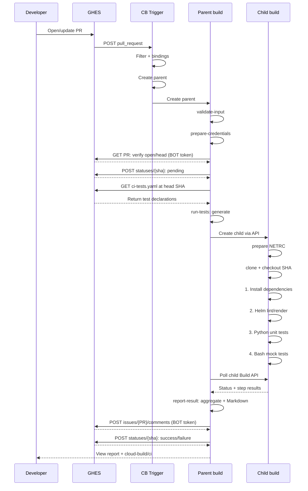

# 企业内部 pull-report-bot —— 从 PR 到 Report 的全链路拆解

> 这篇文档描述的是**你们企业内部正在跑的那套流程**：
> 提交 PR → 触发 Cloud Build 跑 CI → 生成 report → bot 把 report 贴回 PR。
>
> 与仓库里其他文档的关系：
> - [github-bot-principles.md](github-bot-principles.md) —— 讲"Bot / GitHub App 是什么"（原理篇，本文是场景篇）
> - [ci-simulation-enterprise-cloud-build.md](ci-simulation-enterprise-cloud-build.md) —— GHE × Cloud Build 怎么打通
> - [openshift-ci-prow-enterprise.md](openshift-ci-prow-enterprise.md) —— 另一条路（App 自建 Prow）
> - [../demo/pr-check-actions/README.md](../demo/pr-check-actions/README.md) —— 同一件事的"不用 Cloud Build"版本
>
> ★ **标注约定**：
> 〔确认〕= 你明确描述过的；
> 〔推演〕= 我根据你的描述 + GitHub/Cloud Build 的机制**推断**出来的，需要你在实际环境里核对。

---

## 0. TL;DR

**一句话流程：**

> PR 一开 → GitHub 把事件推给 webhook → webhook 把 PR 信息转成一次 Cloud Build 触发
> → build 里跑若干 step（YAML 校验 / bash 校验 / helm lint+template）
> → 收集每步结果 → 拼成一份 markdown **report**
> → 以 `pull-report-bot` 的身份把 report 作为 PR 评论贴回去。

**最关键的一个认知：**

> **"bot" 只是这套系统最后那一小段（回写 report）。前面 90% 的事（触发、执行、判定）是 Cloud Build 在干。**
> 你在 PR 页面看到的 bot 评论，只是 Cloud Build 跑完之后的**输出载体**。
> 换句话说：**CI 的执行器和 CI 的"发言人"是两拨人**。

**三个容易搞混的"角色"：**

| 角色 | 是谁 | 干什么 |
|---|---|---|
| **事件源** | GitHub（PR） | 产生 `pull_request` 事件 |
| **执行器** | Cloud Build（GCP project） | 真正跑测试、判红绿 |
| **发言人** | `pull-report-bot` | 把结果用人类可读的形式贴回 PR |

---

## 1. 你在 PR 页面上看到的现象，逐条对应

〔确认〕你说提交 PR 时"能看到它做了一些对应的校验"，比如分支里的语法校验、YAML 校验、Helm 渲染校验，
最后"用这个 bot 生成了一个 report，直接在 PR 里面显示出来"。

| PR 页面上的现象 | 背后真实发生的事 |
|---|---|
| PR 一提交就开始"转圈"（Checking / Pending） | 事件被接收，Cloud Build 被触发，build 在跑 |
| 某个 bot 账号在 PR 下留了一条长评论（report） | 那条评论就是 `pull-report-bot` 用 API 写的一条 issue comment |
| 评论里有 ✅/❌ 表格，逐项对应各个检查 | 每个 step 的退出码 / 日志被收集后渲染成 markdown |
| 有时你改了代码再 push，PR 上又出现一条新评论 | 每次 `synchronize` 事件都触发一次新 build |
| 你需要去 Settings → Collaborators 给它 write 才能生效 | 它是 **bot user**（不是 App），权限走 collaborator role |

---

## 2. 全链路时序图

```
 开发者          GitHub              webhook/中转        Cloud Build(GCP)      pull-report-bot
    │              │                     │                    │                   │
    │ push 分支     │                     │                    │                   │
    ├─────────────▶│                     │                    │                   │
    │              │                     │                    │                   │
    │ 提 PR         │                     │                    │                   │
    ├─────────────▶│                     │                    │                   │
    │              │                     │                    │                   │
    │              │ ① pull_request 事件  │                    │                   │
    │              │  (webhook POST)     │                    │                   │
    │              ├────────────────────▶│                    │                   │
    │              │                     │ ② 提取 PR/分支/仓库 │                   │
    │              │                     │    决定要跑哪些 step │                   │
    │              │                     │ ③ 触发 build       │                   │
    │              │                     ├───────────────────▶│                   │
    │              │                     │                    │                   │
    │              │                     │                    │ ④ 跑 step:        │
    │              │                     │                    │   · YAML 校验     │
    │              │                     │                    │   · bash -n       │
    │              │                     │                    │   · helm lint     │
    │              │                     │                    │   · helm template │
    │              │                     │                    │                   │
    │              │                     │ ⑤ 拉 build 结果    │                   │
    │              │                     │◀───────────────────┤                   │
    │              │                     │  (步骤/退出码/日志) │                   │
    │              │                     │                    │                   │
    │              │                     │ ⑥ 渲染 report     │                   │
    │              │                     │  (markdown)        │                   │
    │              │                     │                    │                   │
    │              │ ⑦ POST comment     │                    │                   │
    │              │◀────────────────────────────────────────────────────────────┤
    │              │   (issues/{n}/comments,  Authorization: Bearer <token>)     │
    │              │                     │                    │                   │
    │ ⑧ 看到 report │                     │                    │                   │
    │◀─────────────┤                     │                    │                   │
```
- 

---
```txt
Developer        GHES              CB Trigger        Parent build        Child build
   |                |                   |                 |                  |
   |- Open/update PR|                   |                 |                  |
   |--------------->|                   |                 |                  |
   |                |- POST pull_request|                 |                  |
   |                |------------------>|                 |                  |
   |                |                   |- Filter + bindings                |
   |                |                   |- Create parent                    |
   |                |                   |---------------------------------->|
   |                |                   |                 |- validate-input  |
   |                |                   |                 |- prepare-credentials
   |                |<- GET PR: verify open/head (BOT token) ---------------|
   |                |------------------>|                 |                  |
   |                |<- POST statuses/{sha}: pending -----|                  |
   |                |------------------>|                 |                  |
   |                |<- GET ci-tests.yaml at head SHA ----|                  |
   |                |------------------>|                 |                  |
   |                |- Return test declarations --------->|                  |
   |                |                   |                 |- run-tests: generate
   |                |                   |                 |- Create child via API
   |                |                   |                 |----------------->|
   |                |                   |                 |                  |- prepare NETRC
   |                |                   |                 |                  |- clone + checkout SHA
   |                |                   |                 |                  |- 1. Install dependencies
   |                |                   |                 |                  |- 2. Helm lint/render
   |                |                   |                 |                  |- 3. Python unit tests
   |                |                   |                 |                  |- 4. Bash mock tests
   |                |                   |                 |- Poll child Build API
   |                |                   |                 |----------------->|
   |                |                   |                 |<- Status + step results
   |                |                   |                 |- report-result: aggregate + Markdown
   |                |<- POST issues/{PR}/comments (BOT token) --------------|
   |                |------------------>|                 |                  |
   |                |<- POST statuses/{sha}: success/failure ---------------|
   |                |------------------>|                 |                  |
   |<- View report + cloud-build/ci ---|                 |                  |
```


★ 注意 ⑦ 这一段：**从 webhook 服务到 GitHub 的这一次写回，才需要 bot 的权限**。
前面 ①~⑥ 全是 GCP 侧和 GitHub 侧 webhook 之间的内部链路。

> ★ 想看这条链路**拆成 parent build / child build** 的版本（以及什么场景才值得拆），
> 见 [cloud-build-parent-child-builds.md](cloud-build-parent-child-builds.md)。

---

## 3. 阶段拆解（每一步发生了什么、需要什么、怎么排障）

### S0 · 授权阶段：把 bot 放进仓库

〔确认〕`Settings → Collaborators and teams` → 找到 `pull-report-bot` → 给 role（你提到是 write）。

**这一步在系统里到底做了什么：**
GitHub 在该仓库的 collaborator ACL 里加一行 `{user: pull-report-bot, role: write}`。

**为什么是 write 而不是 read？**
- 贴 PR 评论需要 **`issues: write`**（PR 评论走 issue API），write role 覆盖它。
- 如果 bot 还要往仓库里 push 报告文件（比如把 report 提交到 `reports/` 目录），那 write 也是必需的。
- read role **贴不了评论**，所以只读型机器人用 read 就够，报告型必须 write。

⚠️ **role 是仓库侧的 ACL，不是账号侧的能力**：
把 bot 从 collaborator 里删掉，它手里的 token 立刻对该仓库失效。

**需要确认的一点**〔推演〕：
> 既然它在 `Collaborators and teams` 里，说明它**是 bot user，不是 GitHub App**。
> 但 App **不能**被邀请成 collaborator —— 所以它必然是个注册过的用户账号，
> 它背后的服务持有一个 **PAT**（classic 或 fine-grained）。
> → 验证方法：点它的头像看是不是 App 页面；或者看仓库 `Settings → Apps` 里有没有它。

### S1 · 事件阶段：PR 产生事件

〔推演〕触发点通常是这几种之一（需要核对）：

| 触发方式 | 特征 | 备注 |
|---|---|---|
| **A. Cloud Build 2nd gen trigger（github event）** | PR 一开，Cloud Build 自己就起 build | 需要在 GitHub 装 Cloud Build 的 GitHub App；这也是**最省事**的一种 |
| **B. 中转服务收到 webhook 后调 `gcloud builds submit`** | 有一个自建服务在中间 | 你说的"通过 webhook 调用 GCP project 里的 Cloud Build"**听起来像这种** |
| **C. 纯轮询** | 定时扫 PR 列表 | 会有延迟，一般不用 |

**事件的 payload 里能拿到什么**（后面全靠它）：
```
repository.full_name      → owner/repo
pull_request.number      → PR 号
pull_request.head.sha    → 这次改动对应的 commit
pull_request.head.ref    → 分支名
pull_request.base.ref    → 目标分支（main）
installation.id          → 如果是 App，这是换 token 用的
```

★ **一个必须知道的事实**：`pull_request` 事件有 6 种 action：
`opened` / `synchronize`（又 push 了）/ `reopened` / `edited` / `closed` / `ready_for_review`。
真正值得触发 CI 的一般只有 **`opened` 和 `synchronize`**（还要排除 bot 自己触发的循环）。

### S2 · 调度阶段：决定"这次要跑什么"

这一步决定 **step 集合** 和 **增量范围**。

**增量范围**（强烈建议做增量）：
```bash
git diff --name-only --diff-filter=ACMR origin/main...HEAD
```
理由很实在（仓库里已有实证）：`base/git.sh` 有一个**真实的 bash 语法错误**（第 18 行 `if` 少了 `fi`）。
如果做全仓库扫描，这条 check **永远红**，久而久之大家就学会无视它 —— 这是 CI 最常见的死法。

**按文件类型分派到不同 step**：
| 改动的文件 | 派给哪个 step |
|---|---|
| `*.yaml` / `*.yml`（非 Helm 模板） | YAML 语法校验 |
| `*.sh` | Bash 语法校验 |
| `charts/**/templates/*.yaml` | Helm lint + helm template |
| 其他 | 不检查 |

★ **关键边界**：**Helm 模板不是合法 YAML**（里面有 `{{ .Values.x }}`），
普通 YAML parser 会报错。所以它必须单独走 helm —— 这正是"要装依赖就得换 Cloud Build 执行器"的典型场景。

### S3 · 执行阶段：Cloud Build 跑 step

〔确认〕你们用 GCP project 里的 Cloud Build。仓库里已有一个**可直接对照的样例**：
[`ci-simulation/ci-test.yaml`](../ci-simulation/ci-test.yaml)。

**四个 step ↔ Makefile 四个 target 的对应关系**（现成范式）：

| Cloud Build step | id | 本地等价命令 | 干什么 |
|---|---|---|---|
| 0 | `install-deps` | `make install-deps` | 装 helm 等依赖到 `.tools/bin` |
| 1 | `helm-lint-render` | `make test-helm` | `helm lint --strict` + `helm template` |
| 2 | `cluster-onboarding` | `make test-python` | python 单测 |
| 3 | `bootstrap-tests` | `make test-bash` | bash 断言组 |

**为什么"本地和 CI 跑同一条命令"这么重要**：
`make test` 在本地和 CI 里是**同一条命令**，所以"本地过了 CI 挂"基本只剩环境差异。
评审人在本地就能复现 CI 的判定。

**Cloud Build 的三条硬规则**（容器实测踩出来的）：
1. **step 之间只有 `/workspace` 共享** → 工具必须装到 `/workspace/.../.tools/bin`
2. **每个 step 是全新容器** → 每个 step 的 `PATH` 都要显式包含 `.tools/bin`
3. **builder 镜像用 `python:3.11`(full)** → 自带 make/curl/python3/git；`ubuntu:22.04` 这几样一个都没有

**每种检查具体用什么命令**：
```bash
# ① YAML 语法（跳过 Helm 模板目录）
ruby -ryaml -e 'YAML.parse_file(f)'            # 或 python: yaml.safe_load(open(f))
# ② Bash 语法（只做解析，不执行）
bash -n file.sh
# ③ Python 语法
python3 -m py_compile file.py
# ④ Helm
helm lint charts/xxx --strict
helm template myrel charts/xxx > /dev/null
```

★ `bash -n` **只解析不执行** —— 安全，且快。
★ `helm lint --strict` 会把 warning 也当失败 —— 适合做门禁。

---

### S4 · 汇聚阶段：把 step 结果变成 report

**每个 step 需要回传的最小信息**：
```
step 名 / 通过与否 / 耗时 / 关键错误日志片段 / 涉及的文件
```

**渲染成 markdown 表格**（长这样）：
```markdown
## pull-report-bot · PR #123 校验报告

| 检查项 | 结果 | 耗时 |
|---|---|---|
| YAML 语法校验 | ✅ 通过 (12 files) | 1.2s |
| Bash 语法校验 | ❌ 失败 | 0.3s |
| Helm lint | ⏭️ 跳过（本次无改动） | - |
| Helm template | ✅ 通过 | 2.1s |

<details><summary>失败详情</summary>

```bash
scripts/foo.sh: line 18: syntax error near unexpected token 'fi'
```

</details>
```

★ **报告要贴"结论"，不是贴日志**：一行 ✅/❌ + 折叠的详情。
reviewer 要的是"能不能合"，不是 300 行日志。

### S5 · 回写阶段：bot 把 report 贴到 PR

**API（PR 评论 = issue comment）**：
```
POST https://api.github.com/repos/{owner}/{repo}/issues/{pr_number}/comments
Authorization: Bearer <PAT 或 installation token>
{"body": "<rendered markdown>"}
```

**鉴权两条路**（取决于 bot 是 user 还是 App）：

| | bot user（你们现在这种） | GitHub App |
|---|---|---|
| 凭据 | PAT（`ghp_xxx` / `github_pat_xxx`） | installation token（`ghs_xxx`，1h） |
| 怎么拿 | 存在服务配置里 | PEM 私钥 + App ID → 签 JWT → 换 token |
| 过期 | 长期 | 1 小时，要续 |
| 身份显示 | `pull-report-bot` | `pull-report-bot[bot]` |

〔推演〕如果 `pull-report-bot` 在 PR 页面显示成 `pull-report-bot[bot]`（带方括号），
那它其实是 **App**，权限就不该在 collaborator 里给，而应该在 `Settings → Apps` 里 configure。
这个细节需要你在实际 PR 页面上确认一次。

**★ 幂等更新（必须做）**：
每次 push 都会产生一条新评论 → PR 页面很快被几十条 report 淹没。
标准做法：**用隐藏 marker 定位同一条评论，有就更新（PATCH）、没有就新建（POST）**。
```markdown
<!-- pull-report-bot:report -->
```
```bash
# 伪代码
existing=$(list_comments | grep '<!-- pull-report-bot:report -->')
if [ -n "$existing" ]; then PATCH /issues/comments/$id
else POST /issues/{n}/comments
fi
```

### S6 · 门禁阶段：report ≠ check

**必须分清两件事**：

| | report（评论） | check（Checks 标签） |
|---|---|---|
| 长什么样 | 一条 markdown 评论 | PR 页 "Checks" 标签下的一条记录（✅/❌） |
| 能不能做门禁 | ❌ 不能 | ✅ 能（设成 required status check） |
| 作用 | 给人看：哪里错了、怎么改 | 给机器看：不绿就合不进去 |

★ 所以完整形态应该是**两条都要有**：
1. **check**（`checks: write` 或 `statuses: write`）→ 负责"卡不卡"
2. **report 评论**（`issues: write`）→ 负责"看懂哪里错"

只有 report 没有 check → 合并不受控；只有 check 没有 report → reviewer 只看到一个红叉，还得自己去翻日志。

---

## 4. 权限地图（每个环节分别要什么）

| 环节 | 需要的权限 | 在哪授权 |
|---|---|---|
| 接收 PR 事件 | App 的 `pull_request` 事件订阅 | App 设置 / trigger 配置 |
| 触发 Cloud Build | GCP `cloudbuild.builds.create` | GCP IAM（服务账号） |
| 拉 build 结果 | `cloudbuild.builds.get` / logs | GCP IAM |
| 贴 report 评论 | `issues: write`（或 `pull_requests: write`） | collaborator role=write / App permission |
| 上报 check | `checks: write` 或 `statuses: write` | 同上 |
| 读代码 | `contents: read` | 同上（★ trigger 触发的构建 **clone 私有仓库是自动的**，clone 本身不需要凭据） |
| 门禁生效 | required status check | Settings → Branches / Rulesets |

---

## 5. 术语表（把这套流程里所有名词一次讲清）

| 术语 | 一句话解释 | 在你们流程里的位置 |
|---|---|---|
| **bot** | 一个会用 API 代替人干活的账号 | pull-report-bot |
| **collaborator role** | 仓库 ACL 里的权限档（Read/Triage/Write/…） | 你在 Settings 里给 write 的那一步 |
| **PAT** | Personal Access Token，账号的"密码替身" | bot 调 GitHub API 用的凭据 |
| **GitHub App** | 一种独立应用身份，装到 org/repo | 〔推演〕可能另有其 App 负责收 webhook |
| **installation token** | App 换来的临时令牌，1h 过期 | 同上 |
| **webhook** | GitHub 主动 POST 事件给你的服务 | 事件推给中转层 |
| **trigger** | Cloud Build 里的触发器（github event / webhook / 手动） | PR 事件 → build |
| **build** | 一次 Cloud Build 执行 | 一次 PR 校验 = 一次 build |
| **step** | build 里的一个容器步骤 | YAML 校验 / bash 校验 / helm 渲染 |
| **check run** | GitHub 上的"一次检查记录" | 门禁的那一条 |
| **status** | 老的 commit status API（context 形式） | 兼容老门禁 |
| **required status check** | 不绿就不让合并的必过项 | 分支保护规则 |
| **branch protection / ruleset** | 仓库的合并策略 | 让 CI 变硬门禁 |
| **report** | 人类可读的汇总评论 | bot 最后贴的那条 |

---

## 6. 这套流程里最容易踩的坑（按出现频率排序）

### 坑 1 · "check 从未上报" 和 "check 跑了但是红的"，在 PR 上长得一样
两者都表现为 PR 一直 **BLOCKED**。若 required check 加了 `paths:` 过滤，
不改对应文件的 PR 就永远不上报 → 永远卡住，而且看不出卡在哪。
★ **硬规则：要设成 required 的 check，必须保证它在每一个 PR 上都会上报。**

### 坑 2 · 报告评论刷屏
每次 push 一条 → 几十条。必须用 marker 做幂等更新（见 S5）。

### 坑 3 · 全仓库扫描导致"永久红"
历史遗留问题让 check 永远红 → 大家无视 → CI 失去意义。用增量 + 历史问题单独开 PR 修。

### 坑 4 · Bot 权限不够的两种表现
- 完全贴不出评论 → 403 → role/permission 不够（去 Settings → Collaborators 或 Settings → Apps 看）
- 收得到 webhook 但写不进去 → App 的 permission 没勾够（去 Settings → Apps → Configure 补勾，不用重装）

### 坑 5 · App 的自动 approve 不算数
App 型 bot 的 approve 会被 branch protection 拒绝（GitHub 规定 App 不能满足 required review）。
只有 bot **user** 型才可以被当人 review。

### 坑 6 · 构建超时 / 依赖装不上
Cloud Build 每个 step 是独立容器，装好的工具不共享 → 只能靠 `/workspace` + 显式 `PATH`。
参考 `ci-test.yaml` 里那四条注释。

### 坑 7 · 并发提交
同一个 PR 连续 push 两次 → 两个 build 同时跑 → 老 build 后完成，把新结果覆盖成旧结果。
解法：触发时带上 `head.sha`，回写前比较当前 PR 的 head.sha 是否还是你的 sha，不是就丢弃结果。

### 坑 8 · webhook 死循环
bot 自己贴评论 → 若有人把"PR 有新评论"也当成触发条件 → 无限循环。
触发条件只认 `opened` / `synchronize`，并且忽略 bot 自己发起的 PR 事件。

---

## 7. 可改进的方向（按性价比排序）

| 优先级 | 改进 | 收益 |
|---|---|---|
| ★★★ | report 幂等更新（marker + PATCH） | PR 页面不再刷屏 |
| ★★★ | 补上 **check**（不只有 report） | 才能真正做硬门禁 |
| ★★☆ | 触发时带 `head.sha`，回写前比对 | 解决并发覆盖 |
| ★★☆ | 增量检查 + 历史问题单独治理 | 避免"永久红" |
| ★★☆ | 统一"本地 = CI"的入口（`make test`） | 评审人本地能复现 |
| ★☆☆ | 加并发取消（新 build 起来时 cancel 旧的） | 省 GCP 费用 |
| ★☆☆ | 把 report 存一份到 GCS / Artifact | 可追溯、可对比 |
| ★☆☆ | webhook 失败重试 + 死信队列 | 丢事件能发现 |

---

## 8. 一个"如果重做一遍"的标准形态

〔推演〕把这套流程做成工业级的样子，应该是这样：

```
①  GitHub App（专用，名字和 pull-report-bot 分开）
    订阅 pull_request(opened/synchronize) → 直接打到 Cloud Build 2nd gen trigger
    权限：contents:read, checks:write, issues:write, pull_requests:read
②  Cloud Build 2nd gen trigger
    拉 PR 分支 → 跑 steps → 产出结构化结果（json）
③  一个小的 reporter 服务（Cloud Run / GKE）
    读 build 结果 → 渲染 report → 用 installation token PATCH/POST 评论
    + 创建 check run
④  分支保护把 check 设成 required
```
**和你们现在做法的差异**：把"收事件""跑测试""写报告"三件事**拆成三个独立角色**，
每个角色都有自己独立的凭据和独立的扩缩容维度。

---

## 9. 与本仓库其他内容的对应关系

| 仓库里的东西 | 对应本文的哪一段 |
|---|---|
| `ci-simulation/ci-test.yaml` | S3 执行阶段（四个 step 的现成范式） |
| `ci-simulation/Makefile` | S2/S3（本地 = CI 的入口） |
| `demo/pr-check-actions/`（3 条 check） | S3（YAML/bash/清单三类检查的具体命令）+ S6（check 与 report 的区别） |
| `demo/pr-check-actions/branch-protection-main.restore.json` | S6（把 check 变成硬门禁的配置） |
| `cr-check/`（Go 实现） | 同一条链路的另一种实现：webhook 收事件 → 规则判定 → 上报 check |
| `ci-simulation/openshift-ci-prow-enterprise.md` | S1（不靠中转服务，App 直接驱动 CI 的另一种架构） |
| `ci-simulation/github-bot-principles.md` | S0/S5（bot 身份、PAT vs installation token 的原理） |

---

## 10. 需要你去核对的几件事（本文的推演点）

1. `pull-report-bot` 在 PR 页面上显示的名字**带不带 `[bot]`**？
   → 带 = GitHub App（权限应在 Settings → Apps）；不带 = bot user（权限在 Collaborators）。
2. webhook 是**直接进 Cloud Build trigger**，还是**先进一个中转服务**？
   → 决定 S1/S2 的边界在哪，也决定谁是"发言人"。
3. report 是**每次新建一条评论**，还是**更新同一条**？
   → 决定要不要补 marker 幂等逻辑。
4. 目前有没有 **check**（Checks 标签下的记录）？
   → 没有的话，report 只是"给人看"，**没有真正的门禁**。
5. required check 的**触发条件有没有 `paths` 过滤**？
   → 有的话，未改对应文件的 PR 会永远 BLOCKED（坑 1）。
